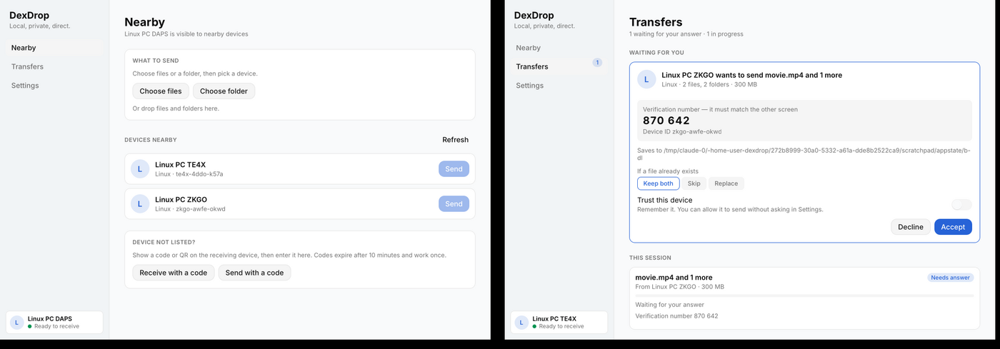
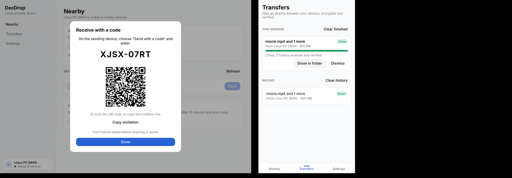
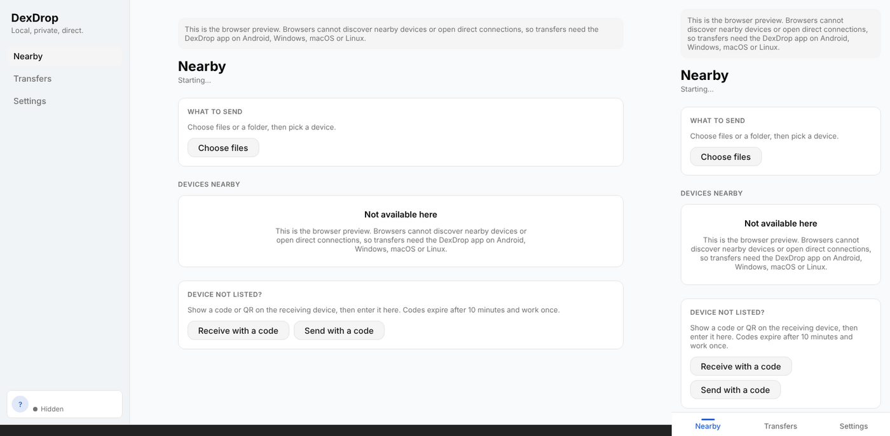

# DexDrop

Fast, private, local file transfer between your devices. No account, no cloud:
files go directly from one device to the other over an encrypted connection,
are verified with BLAKE3, and resume where they left off if the connection
drops.

Built as a Rust-only [Native Shell (NSH)](https://nsh.dev) app (pinned to NSH
`v0.6.1`) on top of a UI-independent Rust transfer engine.

## Platforms

| Platform | State | How it is built |
|---|---|---|
| Linux (x86_64) | **Built and run**: UI, discovery and transfers verified; packaged in CI | `nsh package app --target linux` → `DexDrop.tar.gz` |
| Android | **APK builds**, here and in CI (arm64-v8a, armeabi-v7a); not yet run on a device; nearby discovery needs a native NSD bridge (see [status](docs/STATUS.md)) | `nsh package app --target android` |
| Web | **Builds and runs** (here and in CI) as a browser preview that explains its limits (no LAN discovery or direct sockets in browsers) | `nsh package app --target web` |
| Windows | **Engine tests and throughput bench pass in CI; the app packages in CI**; not yet run interactively | `nsh package app --target windows` |
| macOS | CI job ready; no macOS runner is available to this repository's account yet | `nsh package app --target macos` |
| iOS | Simulator build job ready (no paid Apple membership needed); waits on a macOS runner | `nsh package app --target ios-simulator` |
| CLI (`dexdrop`) | Linux verified; tests and bench pass on Windows in CI | `cargo build --release -p dexdrop-cli` |

See [docs/STATUS.md](docs/STATUS.md) for the PRD requirement-by-requirement
status, and [docs/ARCHITECTURE.md](docs/ARCHITECTURE.md) for the design and
the transport decision.

## What it does today

- Nearby discovery over DNS-SD/mDNS (`_dexdrop._tcp`), deduplicated by peer ID.
- Pairing fallbacks: an 8-character code (`K7P2-QX9M`) or a QR/link invitation;
  both expire after 10 minutes, are single-use, and five wrong codes lock them.
- Mutual TLS 1.3 with per-device Ed25519 identities; peers are pinned by ID and
  both screens show the same 6-digit verification number.
- Receiver consent for every transfer (optional auto-accept for devices you
  explicitly trusted), with keep-both / skip / replace (confirmed) conflict handling.
- Files and folders (including empty ones), streamed in chunks with bounded
  memory; per-chunk and whole-file BLAKE3; a file that fails verification is
  requested again once and never saved if it keeps failing.
- Temporary files and atomic commit; journaled progress; pause/resume and
  automatic reconnect that continue from the last verified chunk; resume after
  an app restart.
- Path safety: absolute paths, traversal, symlink escapes and malformed
  manifests are rejected; Windows-reserved names are made portable.
- Local-only settings, trusted devices, history and anonymized diagnostics.

On loopback the full pipeline (TLS + hashing + disk) runs at roughly
340–480 MB/s for large files, 620 MB/s for photo-sized files and about
3,700 small files per second on the build container (`dexdrop bench`,
`dexdrop bench --files 20000`), several times what gigabit Ethernet
carries. See [docs/ARCHITECTURE.md](docs/ARCHITECTURE.md#measured-performance).

## Repository layout

```text
app/                    NSH Rust app (UI, state, bridge to the engine)
crates/dexdrop-core/    identity, protocol, manifests, path safety, journals,
                        invitations, stores, and the UI-facing API types
crates/dexdrop-net/     TLS transport, sessions, mDNS discovery, engine actor
crates/dexdrop-cli/     `dexdrop` command-line tool and throughput bench
docs/                   architecture, protocol and status
.github/workflows/      CI: tests on Linux/Windows/macOS, packages per platform
```

## Building

Requirements: Rust (stable, 1.85+) and, for the app, NSH `v0.6.1`:

```sh
curl -fsSL https://nsh.dev/install.sh | NSH_VERSION=v0.6.1 sh
```

Linux additionally needs GTK 4.14+, clang and GStreamer development packages
(the NSH Linux runner links them):

```sh
sudo apt-get install libgtk-4-dev clang libgstreamer1.0-dev libgstreamer-plugins-base1.0-dev
```

```sh
cargo test --workspace                     # engine, protocol, adversarial and headless UI tests
cargo run -p dexdrop-app                   # the app on this desktop
nsh package app --target linux             # or windows, macos, web, android, ios-simulator
cargo run --release -p dexdrop-cli -- bench --mb 1024
```

Android packaging needs the Android SDK (`platforms;android-35`,
`build-tools;35.0.1`, `platform-tools`), an NDK (`ANDROID_NDK_HOME`), the Rust
Android targets and `nsh component add android`. The APK is signed with the
debug key unless `--keystore` is passed.

### Command line

```sh
dexdrop receive --dir ~/Downloads/DexDrop --invite   # shows a code and an invitation
dexdrop peers
dexdrop send "Studio Mac" ./photos ./notes.pdf       # by name, peer-ID prefix,
dexdrop send K7P2-QX9M ./video.mp4                   # code, invitation (DEXDROP1:…)
dexdrop send 192.168.1.20:47820#<peer-id> ./file     # or address (optionally pinned)
```

### Environment variables (development)

| Variable | Effect |
|---|---|
| `DEXDROP_STATE_DIR` | Where the app keeps identity and state |
| `DEXDROP_DOWNLOAD_DIR` | Default folder for received files |
| `DEXDROP_NO_DISCOVERY` | Disable mDNS (tests) |
| `DEXDROP_PORT` | Fixed listening port |

## Apple distribution

No paid Apple Developer Program membership is assumed. The iOS app is built
for the simulator; physical-device testing is possible with a free Personal
Team. DexDrop is **not** available on the App Store or TestFlight.

## Screenshots (Linux build, GTK)

Two instances discovering each other; incoming request with verification number:



Pairing code and QR invitation; the phone layout with bottom tabs:



Web preview:


