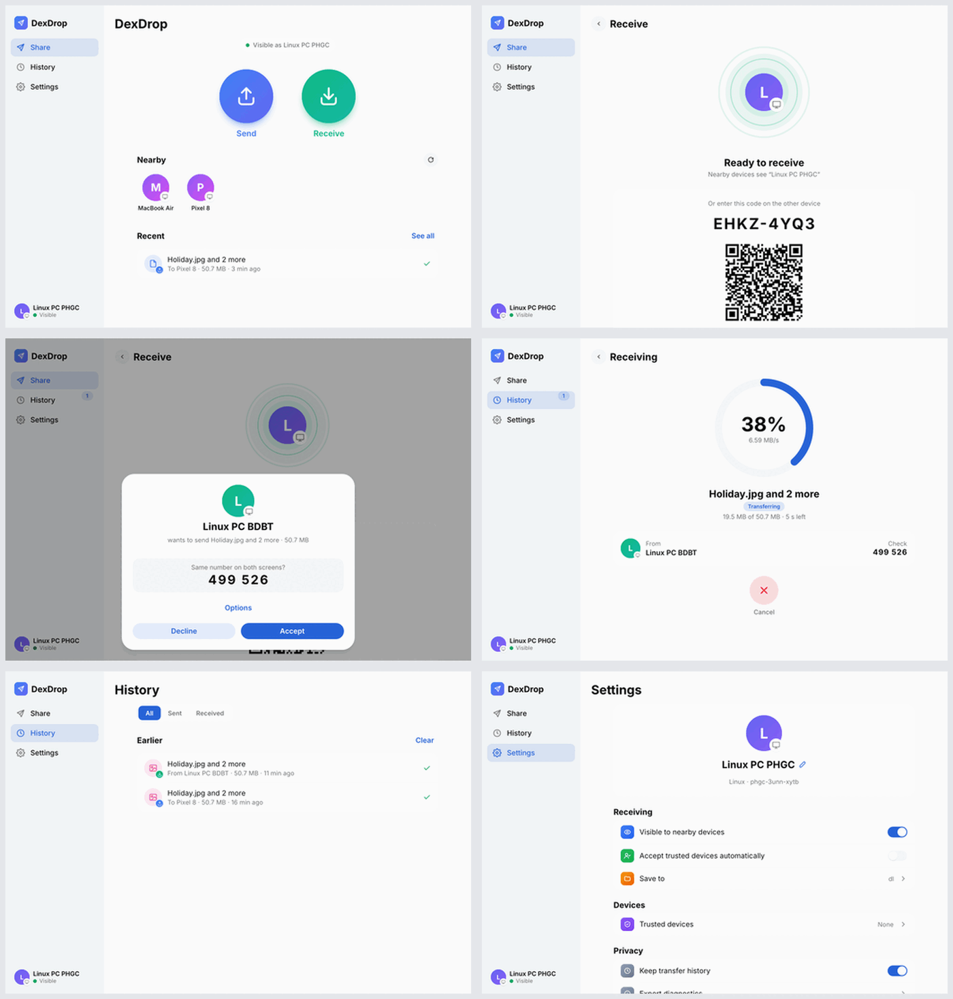
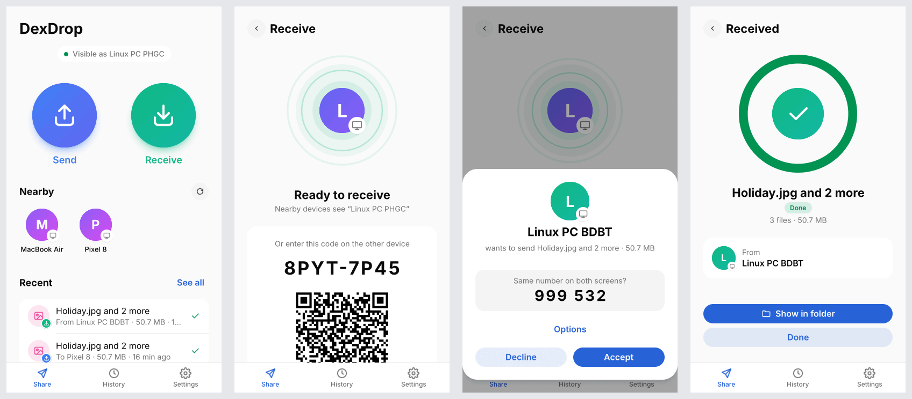

# DexDrop

Fast, private, local file transfer between your devices. No account, no cloud:
files go directly from one device to the other over an encrypted connection,
are verified with BLAKE3, and resume where they left off if the connection
drops.

Built as a Rust-only [Native Shell (NSH)](https://nsh.dev) app (pinned to NSH
`v0.6.1`) on top of a UI-independent Rust transfer engine.

## Platforms

| Platform | State | How it is built |
|---|---|---|
| Linux (x86_64) | **Built and run**: UI, discovery and transfers verified; the packaged app is checked end to end in CI | `nsh package app --target linux` → `DexDrop.tar.gz` |
| Android | **Checked end to end in an emulator in CI** (arm64-v8a, armeabi-v7a, x86_64 APK): discovery both ways through the system's NsdManager, files received with a pairing code and with the invitation from the QR code; not yet run on a phone | `nsh package app --target android` |
| Web | **Builds and runs** (here and in CI) as a browser preview that explains its limits (no LAN discovery or direct sockets in browsers) | `nsh package app --target web` |
| Windows | **Packaged app verified end to end in CI**: discovered by the CLI, receives a file and a folder byte-identical, records it in history; engine tests and bench pass | `nsh package app --target windows` |
| macOS | **Packaged app verified end to end in CI** on GitHub's free `macos-15` runners: local-network prompt answered, discovery both ways, a file and a folder received byte-identical | `nsh package app --target macos` |
| iOS | Simulator build in CI on `macos-15`, driven by agent-device: finds the Mac and is found, receives files sent with a pairing code and with an invitation link, byte-identical (no paid Apple membership needed) | `nsh package app --target ios-simulator` |
| CLI (`dexdrop`) | Linux verified; tests and bench pass on Windows and macOS in CI, where it drives the desktop checks | `cargo build --release -p dexdrop-cli` |

Having trouble finding a device or finishing a transfer? See
[docs/TROUBLESHOOTING.md](docs/TROUBLESHOOTING.md). What changed and what was
tested: [docs/RELEASE_NOTES.md](docs/RELEASE_NOTES.md).

See [docs/STATUS.md](docs/STATUS.md) for the PRD requirement-by-requirement
status, and [docs/ARCHITECTURE.md](docs/ARCHITECTURE.md) for the design and
the transport decision.

## What it does today

- Nearby discovery over DNS-SD/mDNS (`_dexdrop._tcp`), deduplicated by peer ID: the system's Bonjour service on macOS and iOS, a built-in responder elsewhere.
- Pairing fallbacks: an 8-character code (`K7P2-QX9M`) or a QR/link invitation;
  both expire after 10 minutes, are single-use, and five wrong codes lock them.
- Mutual TLS 1.3 with per-device Ed25519 identities; peers are pinned by ID and
  both screens show the same 6-digit verification number.
- Receiver consent for every transfer (optional auto-accept for devices you
  explicitly trusted), with keep-both / skip / replace (confirmed) conflict handling.
- Files and folders (including empty ones), streamed in chunks with bounded
  memory; per-chunk and whole-file BLAKE3; a file that fails verification is
  requested again once and never saved if it keeps failing.
- Temporary files and atomic commit; journaled progress; pause/resume and
  automatic reconnect that continue from the last verified chunk; resume after
  an app restart.
- Path safety: absolute paths, traversal, symlink escapes and malformed
  manifests are rejected; Windows-reserved names are made portable.
- Over the internet (Iroh): devices you exchanged files with ("Your
  devices") and invitation links work from any network, on a direct path
  when hole punching succeeds and through a relay otherwise; the app always
  says which. Local transfers stay on the local network.
- On-device settings, trusted devices, history and anonymized diagnostics.

On loopback the full pipeline (TLS + hashing + disk) runs at roughly
340–480 MB/s for large files, 620 MB/s for photo-sized files and about
3,700 small files per second on the build container (`dexdrop bench`,
`dexdrop bench --files 20000`), several times what gigabit Ethernet
carries. See [docs/ARCHITECTURE.md](docs/ARCHITECTURE.md#measured-performance).

## Keyboard

| Where | Keys |
|---|---|
| Home | `S` or `←` Send, `R` or `→` Receive |
| Send | `Return` on to the devices (or to the device picked); `⌘/Ctrl+O` choose files, `⌘/Ctrl+Shift+O` a folder |
| Choose device | `↑` `↓` move, `Return` send to it, `A` send to all nearby |
| A request | `Return` accept, `Esc` decline |
| A transfer | `Space` pause or resume, `O` open what came in |
| Anywhere | `⌘/Ctrl+1` `2` `3` Share, History, Settings; `Esc` back |

Hold (or right-click) a past transfer to remove it from History, or a
device under *Your devices* to forget it; both ask first.

## Repository layout

```text
app/                    NSH Rust app (UI, state, bridge to the engine)
crates/dexdrop-core/    identity, protocol, manifests, path safety, journals,
                        invitations, stores, and the UI-facing API types
crates/dexdrop-net/     TLS transport, sessions, discovery (Bonjour, mDNS), engine actor
crates/dexdrop-cli/     `dexdrop` command-line tool and throughput bench
docs/                   architecture, protocol and status
.github/workflows/      CI: tests on Linux/Windows/macOS, packages per platform
```

## Building

Requirements: Rust (stable, 1.85+) and, for the app, NSH `v0.6.1`:

```sh
curl -fsSL https://nsh.dev/install.sh | NSH_VERSION=v0.6.1 sh
```

Linux additionally needs GTK 4.14+, clang and GStreamer development packages
(the NSH Linux runner links them):

```sh
sudo apt-get install libgtk-4-dev clang libgstreamer1.0-dev libgstreamer-plugins-base1.0-dev
```

```sh
cargo test --workspace --features dexdrop-net/test-relay   # engine and headless UI tests (~25 s)
(cd app && nsh test e2e/app.test.ts --target linux)        # the real app; macos, windows, ios, android too
cargo run -p dexdrop-app                   # the app on this desktop
nsh package app --target linux             # or windows, macos, web, android, ios-simulator
cargo run --release -p dexdrop-cli -- bench --mb 1024
```

Testing follows NSH's recommendations, headless first: see
[docs/TESTING.md](docs/TESTING.md).

Android packaging needs the Android SDK (`platforms;android-35`,
`build-tools;35.0.1`, `platform-tools`), an NDK (`ANDROID_NDK_HOME`), the Rust
Android targets and `nsh component add android`. The APK is signed with the
debug key unless `--keystore` is passed.

### Command line

```sh
dexdrop receive --dir ~/Downloads --invite   # shows a code and an invitation
dexdrop peers
dexdrop send "Studio Mac" ./photos ./notes.pdf       # by name, peer-ID prefix,
dexdrop send K7P2-QX9M ./video.mp4                   # code, invitation (DEXDROP1:…)
dexdrop send 192.168.1.20:47820#<peer-id> ./file     # or address (optionally pinned)
```

### Environment variables (development)

| Variable | Effect |
|---|---|
| `DEXDROP_STATE_DIR` | Where the app keeps identity and state |
| `DEXDROP_DOWNLOAD_DIR` | Default folder for received files |
| `DEXDROP_NO_DISCOVERY` | Disable mDNS (tests) |
| `DEXDROP_PORT` | Fixed listening port |
| `DEXDROP_RELAY_URL` | The relay for internet transfers (your own `iroh-relay`); n0's public relays otherwise |

## Apple distribution

No paid Apple Developer Program membership is assumed. The iOS app is built
for the simulator; physical-device testing is possible with a free Personal
Team. DexDrop is **not** available on the App Store or TestFlight.

## Screenshots

Desktop (Linux build): home with *Send*, *Receive* and nearby devices; the
Receive page with its code and QR code; an incoming request with the
verification number; progress; History; Settings:



Phone layout (the same build at phone width; on iOS and Android the tab bar
and switches are the system's own): home, Receive, an incoming request,
received:


